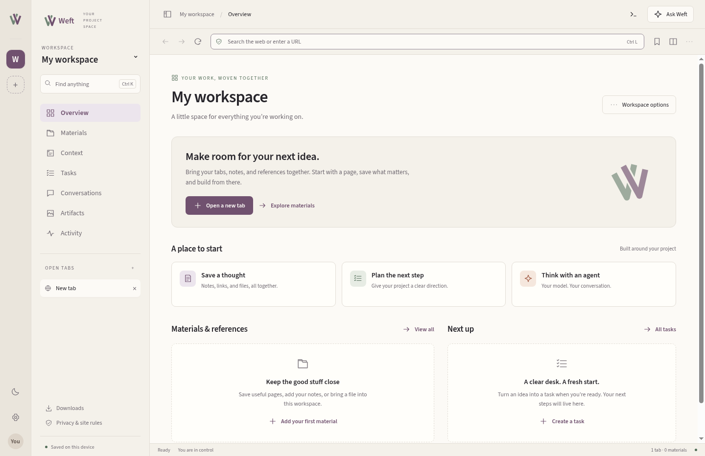

# Weft

A local-first workspace browser for people and their chosen agents. Weft brings
Chromium tabs, materials, project context, tasks, conversations, and saved page
captures into persistent workspaces. The GUI, CLI, authenticated REST API, and
MCP bridge use one validated command catalog.

The interface follows the supplied [visual style guide](Weft-Visual-Style-Guide.md)
and uses the supplied logo assets, locally bundled Source Sans 3, warm ivory
surfaces, plum controls, and deliberate light/dark themes.



## Run

Requires **Node.js 22.12+**, npm, and a desktop session. Electron supplies Chromium.

```sh
npm ci
node node_modules/electron/install.js
npm start
```

The API binds only to `127.0.0.1:9222`. Without `WEFT_TOKEN`, the browser generates
a random token and prints it to the local terminal. For automation, choose a
strong token and use it in both processes:

```sh
export WEFT_TOKEN="$(node -e "console.log(require('node:crypto').randomBytes(32).toString('hex'))")"
npm start
```

Set `WEFT_PORT` to change the port. In PowerShell, use `$env:WEFT_TOKEN = ...`.
A desktop display is required. On headless Linux, `xvfb-run -a npm start` provides
a virtual display. Normal startup keeps Chromium's sandbox enabled.

### Installers and updates

Stable releases are packaged for Windows x64 (branded per-user NSIS installer),
macOS arm64/x64 (dmg/zip) and Linux x64 (AppImage/deb) from GitHub Releases of
`jxburros/Weft`. Settings > Updates shows the installed version, the stable
channel and any verified staged update. Weft contacts GitHub only when you choose
Check now or turn on daily checks; downloads are size- and SHA-512-verified and
installed only when you choose. `WEFT_DISABLE_UPDATES=1` turns all update traffic
off. Upgrades and uninstalls keep your workspaces unless you explicitly remove
them. Release, signing and support details: [docs/RELEASING.md](docs/RELEASING.md).
Code signing and notarization depend on credentials that are not yet configured,
so current builds are labelled unsigned.

## What you can do

- **Browse:** address/search bar, native Chromium pages, separate workspace
  sessions, back/forward, reload/stop, pinned/duplicated/moved tabs, split view,
  find, zoom, browsing history, bookmarks, downloads, and PDF output.
- **Organize:** create, rename, duplicate, archive, restore, and export workspaces;
  keep editable notes, website references, and copied files; track confirmed
  information, findings, questions, instructions, and decisions.
- **Continue work:** save task objectives, owners, states, blockers, checkpoints,
  and next steps. Turn reusable workflow instructions into queued human tasks.
- **Keep evidence:** save readable page text and PNG screenshots as immutable
  capture versions. Open them offline without executing source HTML or contacting
  the original site. Capture limitations and source metadata remain visible.
- **Choose a model:** use OpenAI-compatible cloud/local endpoints or Anthropic;
  retain conversations across model changes; explicitly include project context.
  Optional read-only tools can read a selected tab and search its workspace.
- **Set boundaries:** create personal site rules, block redirects and covered
  background requests, inspect browser-owned stop pages, allow an exact visit,
  clear site data, take control of an agent-held tab, and stop agent activity.
- **Automate externally:** discover the same typed commands through CLI, MCP,
  or authenticated REST. Tab versions reject stale input after handoff.

The app starts with one empty workspace. Screenshots in this repository show the
real interface; tests use clearly separate fixture profiles and local websites.

## Keyboard controls

| Shortcut | Action |
| --- | --- |
| Ctrl/Cmd K | Search project records and actions |
| Ctrl/Cmd L | Focus the address bar |
| Ctrl/Cmd T | New tab |
| Ctrl/Cmd W | Close the current tab |
| Ctrl/Cmd F | Find in page |
| Ctrl/Cmd J | Downloads |
| Escape | Close the current dialog |

Use the top-right **Ask Weft** button for conversations and the command icon for
the complete command desk. Sidebar controls remain usable without configuring
any model.

## Model connections

Open **Settings → Model connections**. Configure the exact endpoint and model ID
supported by your provider. The included entries are editable starting points,
not a claim that an account, endpoint, or model is available.

OpenAI-compatible API bases normally end in `/v1`; a local Ollama example is
`http://127.0.0.1:11434/v1`. The Anthropic adapter uses its messages API. An API key
may be supplied through a named environment variable (`OPENAI_API_KEY` and
`ANTHROPIC_API_KEY` are initial defaults), or saved using OS-backed Electron
`safeStorage`. Plaintext key-storage fallbacks are refused. Model keys live in a
separate file and are excluded from project exports.

The panel shows the destination before sending. Inference happens at that
endpoint; local connection failures never silently select a cloud provider.
Text, explicit project context, and enabled read-only tool results may be sent.
Read-only tools require both an enabled model profile and the message's explicit
opt-in. They are limited to the selected tab and conversation workspace, allow
at most five calls, and cannot click, fill forms, change policies, or execute
arbitrary code. Tool results retain their source and are expandable in chat.

Replies stream as they are written. **Attach** adds a tab snapshot, materials,
context, tasks, exact capture versions or a pasted passage; before sending, the
review lists what the selected model receives item by item, lets you exclude
items, and shows when older history is omitted to fit the model's context window
(your saved conversation is never rewritten). Images go only to connections you
mark or discover (`models.probe`) as image-capable, or to a vision fallback you
configure, after acknowledgement. Each reply shows endpoint locality,
provider-reported tokens and, if you set prices, a labeled cost estimate. The
Ollama native API (`http://127.0.0.1:11434`) is also supported.

Autonomous task execution is not implemented. Errors, cancellation, and
unsupported responses are shown as such; a stopped reply is kept and marked
interrupted, and the application does not manufacture an assistant reply.

## CLI and MCP

Keep the browser running and give the CLI the same token:

```sh
node bin/weft.js commands
node bin/weft.js workspaces.list
node bin/weft.js tabs.new '{"url":"https://example.com"}'
node bin/weft.js page.readable
node bin/weft.js materials.create '{"title":"Research note","content":"Questions to explore","kind":"note"}'
node bin/weft.js tasks.create '{"title":"Review the source","objective":"Check the evidence"}'
node bin/weft.js artifacts.capture '{"kind":"bundle","title":"Source reference"}'
```

`npm run cli -- <command> '<JSON arguments>'` is equivalent. `npm link` optionally
installs the `weft` command. Command outcomes, including command failures, are
JSON on stdout; process/protocol diagnostics use stderr. See
[the command contract](docs/COMMANDS.md) for stable error and exit codes. Screenshots require a visible tab. Hidden-tab bundles retain readable text
and report an unavailable image rather than inventing one.

For MCP, configure your client:

```json
{
  "mcpServers": {
    "weft": {
      "command": "node",
      "args": ["/absolute/path/to/Weft/bin/weft.js", "mcp"],
      "env": {
        "WEFT_TOKEN": "<same token as the running browser>",
        "WEFT_API_URL": "http://127.0.0.1:9222"
      }
    }
  }
}
```

MCP advertises eight grouped tools, including `weft_reference` for command
discovery. Execution tools accept a canonical command as `action` and its `args`;
legacy underscore names such as `page_readable` remain accepted but unadvertised.
Schemas and structured outcomes are shared. Screenshots retain MCP image content.
The bridge writes only protocol messages to stdout. `WEFT_API_URL` accepts loopback HTTP origins only and clients
do not follow redirects.

## REST and authority

Requests require `Authorization: Bearer <token>`:

- `GET /v1/commands` returns descriptions and input schemas.
- `GET /v1/openapi.json` returns the generated OpenAPI 3.1 contract.
- `GET /v1/events` streams authenticated command metadata through SSE, without
  arguments, page content, model messages, credentials, or results. Reconnect
  with `Last-Event-ID` to replay recently retained events.
- `GET /v1/turns/{turnId}/events` follows or resumes one model turn; send
  `Accept: text/event-stream` to `POST /v1/execute` to stream a turn you start.
  See [agent integration](docs/AGENT-INTEGRATION.md).
- `POST /v1/execute` accepts `{ "command": "...", "args": {} }` and returns
  a versioned outcome with `schemaVersion`, `command`, `execution`, `validation`,
  `review`, `workspaceId`, `tabId`, `normalized`, `result` and `error`.
  See [the command contract](docs/COMMANDS.md) for status and error meanings.

Discovery is the authoritative list of available commands and arguments. Unknown
fields are rejected. API request bodies are capped at 1 MiB, so large file imports
should use the GUI. REST rejects browser-origin requests and does not enable CORS.

Human-only policy, configuration, storage-administration, override, and takeover
commands appear in discovery but reject automation callers. Every other agent
command passes one authority gate (ADR-005): reads run, local work runs at the
default level, and external actions such as clicks, form fills, scripts and model
sends wait in the Agent requests queue until you approve them once or for a
period, unless you granted standing autonomy. The bootstrap token defaults to
standing autonomy; lower it in Settings → Agent connections. There, issue a
separate token for each client with a purpose, workspace restrictions (several
workspaces need an explicit cross-workspace grant), read/record-write/tab-control
scopes, allowed sites, readable data classes, an autonomy level, an optional
command limit and a finite lifetime. Changes and revocation take effect on every
subsequent command and event; idle event streams close at their next heartbeat.
Tokens are displayed once and never stored in the project. Scoped clients cannot
execute page scripts or send to models unless granted, configure providers,
change site policy, approve requests, or mint other tokens. Activity records
decisions, approvals and outcomes with hash-chain tamper evidence and
configurable retention; it is not proof that an external action succeeded. This remains a
local single-user application, not a remote multi-user service. Takeovers revoke leases and state versions, but cannot undo
an external action or arbitrary page script that already executed.

## Persistence and portability

Electron uses its OS application-data directory by default. Use a separate
profile with:

```sh
npm start -- --user-data-dir=/absolute/path/to/profile
```

Project records are stored under `workspace-data/`; Chromium storage uses a
persistent partition per workspace. Tabs reopen their URLs after restart, without
restoring arbitrary JavaScript state or unsent form input. Moving a tab opens it
in the destination workspace's storage container and may change its login state.
The original foundation's shared `persist:weft` session is not merged into new
workspace containers.

Exports include versioned project records, copied material bytes, and captures.
They exclude browser sessions, configured model keys, and global policies.
Imports create new IDs and leave imported rules/workflows inactive for review.
Copies use this same behavior. Linked-file/service entries are manual reference
metadata; their sources are not automatically copied or refreshed.

The project store is a bounded, single-process JSON file written with atomic
replacement. It is **not encrypted**, and is not a transactional multi-process
database. Stored materials are limited to 10 MiB, PNGs to 20 MiB, and total
project state to 100 MiB. Exports are the current manual backup mechanism.
Free-form content, files, and captures can contain private data; export does not
perform comprehensive secret or personal-information redaction.

## Implementation coverage

This is a working browser build, **not every requirement in the full product
specification**. The exact section-by-section and acceptance-criteria assessment
is in [implementation coverage](docs/IMPLEMENTATION.md).

The largest remaining capabilities are the isolated credential/payment broker,
fine-grained agent grants and autonomous execution, comprehensive storage
block/session modes, a community-list management screen and any hosted moderation service, synchronization,
and signed (rather than labelled-unsigned) installers verified on real machines. Browser extension support is limited to unpacked
Manifest V3 extensions installed per workspace with audited permissions
([ADR-007](docs/decisions/007-extension-compatibility.md)); Weft plugins are
described in [docs/PLUGINS.md](docs/PLUGINS.md). Provider key storage is not a credential
broker. The application does not make strong secret-isolation claims against
agents that can control the host computer.

Remote pages are sandboxed and have no Node integration or privileged preload.
Unsupported protocols and native launches are blocked; permission requests are
denied. Site rules cover documented Chromium request paths, not an external
agent's independent network tools. Unsolicited downloads are cancelled and can be approved from Downloads. Downloads are never executed automatically
and are not claimed to have been scanned for malware. Keep Electron current for
Chromium security fixes.

## Development and validation

```sh
npm test
npm run test:docs
npm run evals
npm run test:perf
# Include actual Chromium and GUI tests on headless Linux:
xvfb-run -a npm test
# Package locally (outputs in dist/, see docs/RELEASING.md):
npm run dist -- --linux AppImage
```

No bundler or compilation step is needed. Tests cover command validation,
authentication, REST/CLI/MCP, model HTTP fixtures and tool boundaries, persistence,
imports/exports, native Chromium isolation and control, and complete GUI workflows
including a real offline capture. Display tests explicitly skip when no display
is available. Test subprocesses use `--no-sandbox` only for CI environments without
a configured sandbox helper; normal application startup does not.

Agent contributors should read [AGENTS.md](AGENTS.md). The packaged
[Weft skill and MCP plugin](docs/AGENT-INTEGRATION.md) use a shared guidance
registry. [Offline task evals](evals/README.md) measure reference success and tool
calls; [performance budgets](perf/README.md) cover large-store writes, capture
search and catalog generation. [Architecture decisions](docs/decisions/) record
current scope, the plugin/extension boundaries and outstanding encryption work.

The font's license is included in `assets/fonts/LICENSE.md`. Logo provenance and
variants are documented in [assets/logo/README.md](assets/logo/README.md).

Command and tool changes are checked by the [offline evals](evals/README.md),
[generated reference](docs/COMMANDS.md), and [validation pipeline](docs/VALIDATION.md).
The [issue disposition](docs/ISSUE-STATUS.md) records completed work and remaining gaps.
